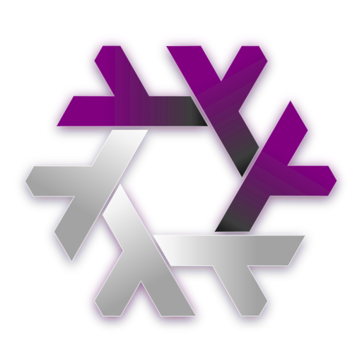

<div align="center">



<p><i>Four machines, one flake, no machine record.</i></p>

</div>

Two NixOS workstations, an Apple silicon Mac, and a CachyOS laptop running
standalone Home Manager, composed from one Den entity/aspect tree. A second flake
builds the personal live ISO and installer from the real `remembrance`
workstation profile.

Host identity lives in `modules/aspects/inventory.nix`. Everything else is an
aspect: the flake has no machine authority, no per-host disk binding, and no
second source for a key, cache, or package pin.

## Hosts

| Host | System | Role | Apply with |
| --- | --- | --- | --- |
| `remembrance` | NixOS `x86_64-linux` | `workstation-role-linux` | `nix run .#build-switch` |
| `antagony` | NixOS `x86_64-linux` | `workstation-role-linux` | `nix run .#build-switch` |
| `entropy` | nix-darwin `aarch64-darwin` | `workstation-role-darwin` | `nix run .#build-switch` |
| `massive` | CachyOS `x86_64-linux` | standalone Home Manager and `systemConfigs.massive` | `nix run .#home-switch` |

## Quickstart

```bash
nix run .#build          # build the current host, change nothing
nix run .#build-switch   # build and activate the current host
nix run .#home-switch    # activate the standalone Home Manager profile
nix run .#update         # refresh flake inputs and theme source pins
nix run .#clean          # drop generations older than seven days
```

`build` and `build-switch` use the current hostname. `zix` is the developer
tool: `nix run .#zix -- --help`. The only configured shells are Nushell, the
login shell, and Bash, the fallback.

## Layout

```text
flake.nix            inputs and one mkFlake call
modules/aspects/     the flat Den tree: hosts, roles, platforms, features
modules/flake/       flake-parts outputs: apps, checks, packages, systems
modules/nixos/       NixOS payload and the NixOS Home Manager module
modules/linux/       Linux Home Manager payload
modules/shared/      cross-platform Home Manager payload
modules/darwin/      nix-darwin payload and macOS Home Manager module
modules/standalone-linux/  Home Manager and system-manager layer for massive
distro/              separate flake: live ISO, installer, live and installed profiles
tests/, distro/tests/  evaluation, architecture, and installer checks
lib/                 keys, caches, nixpkgs policy
pkgs/                repo-local derivations
tools/zix/           the developer CLI, its own flake
docs/                the fleet manual and the logo
```

## Documentation

[docs/NIXOS.md](docs/NIXOS.md) is the single manual: composition, every host
layer, the desktop session, applications, secrets, updates, the distro, and the
checks. Agent rules live in [AGENTS.md](AGENTS.md).

## Checks

```bash
nix flake check --all-systems --no-build
bash tests/prose.sh
cd distro && nix flake check
```
